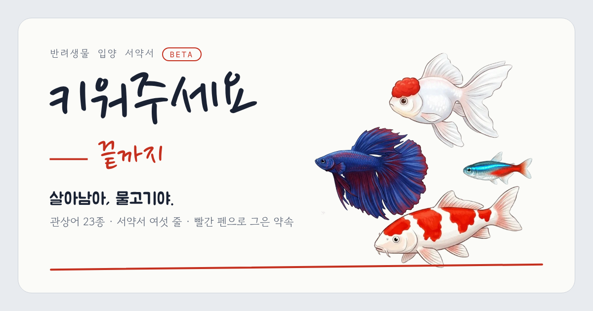
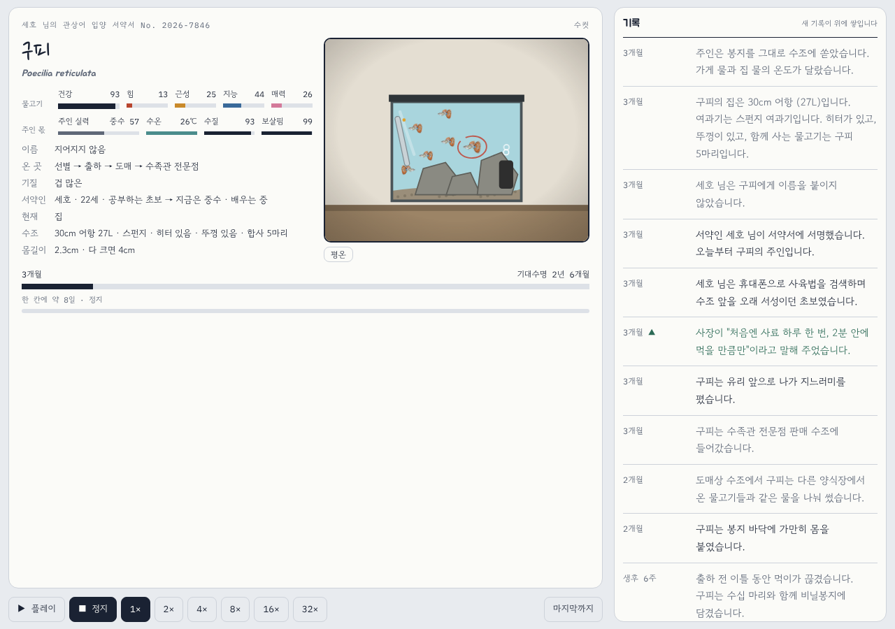
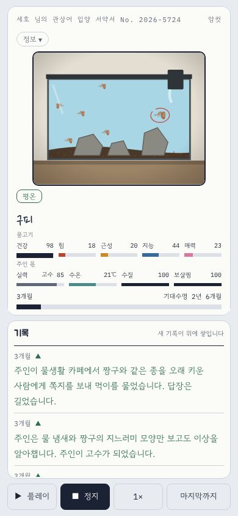
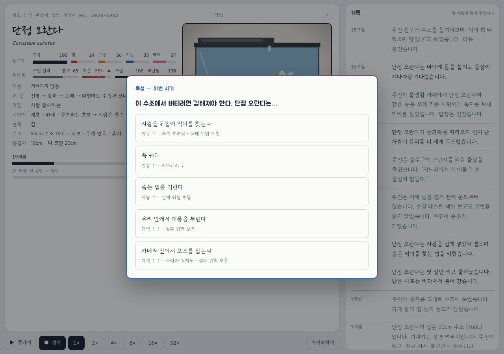
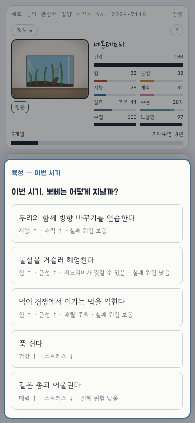

# 키워주세요 — 끝까지 (*Keep Me — Until the End*)

A browser life-simulation about the promises we make to the animals we keep.

<p align="center">
  <a href="https://keep-me-until-the-end.onrender.com"></a><br>
  <sub>Free · no sign-up · phone, tablet and desktop · in Korean</sub>
</p>

[](https://keep-me-until-the-end.onrender.com)

> One of 23 ornamental fish is born in a river or on a farm, survives (or doesn't) the net,
> the sorting sieve, the shipping box and the shop tank, and goes home with an owner who has
> signed six promises. You choose its temperament, make its choices when it matters, raise it
> through the seasons — and watch which promises are struck out in red pen.

**Status:** public beta (v0.12.0, *관상어 데이* — "ornamental fish day": fish only) · **Live:** [keep-me-until-the-end.onrender.com](https://keep-me-until-the-end.onrender.com) · **Stack:** plain HTML / CSS / JavaScript, no build step · **Hosting:** Render static site + Supabase (shared memorial) · **Language:** the game is in Korean; all documentation is in English

> **Content warning.** Neglect, breeding mills, smuggling, fish eaten by tankmates or flushed
> alive are told plainly. Since v0.10 bad endings describe, from outside and in plain veterinary
> terms, what happens to the gills, skin and organs — no inner voice, no exaggeration, no gore in
> the drawings. Intended for ages 15+.

| Desktop — one screen: tank and gauges left, log right | Phone — tank on top, log below, controls at the bottom |
|---|---|
|  |  |
|  |  |

## What happens in a life

1. **The pledge.** Sign the adoption pledge with a nickname; a slot machine draws one of 23 fish.
2. **Before any owner.** Wild fish face the net; farmed fish face the sorting sieve. Then the
   box, the wholesaler, the shop tank — about a quarter die here, as in the trade.
3. **The owner.** One of 22 kinds of people, from the expert and the over-eager beginner to the
   no-filter believer, the medicine hoarder, the office tea-room tank, the temple release ceremony,
   the unboxing YouTuber and the grandmother given a tank as a present — each with a tank, filter,
   heater, lid, layout and tankmates that fit (or don't). Some learn after a near miss, some know
   the fix and put it off, some learn the wrong lesson. Owners change: a fish can be passed on
   through a second-hand app, a move, a hospital stay or a break-up, and a charming fish is more
   often taken by someone who will try.
4. **Raising the fish.** Five stats of its own — health (HP), strength, guts, wits and charm — and
   four the owner keeps — skill, water temperature, water quality and care. Each species has its own
   ceiling and training speed (a neon tetra never gets strong, a gar does), and its own training,
   each with a hidden cost (an arowana that practises jumping jumps more). Every few months a schedule
   card decides how the weeks are spent; every choice shows what it changed. A training repeated goes
   up to Lv.3, and the training level opens ★ special trainings (staring down a tankmate, playing
   dead, a double jump, surfing the filter outlet…). The stat the player builds opens a route —
   star, tyrant, genius, survivor — and each route has a climax that can end the life either way.
5. **Events.** About 370 catalogue events across the whole chain — capture, export, air cargo,
   shop tanks, the home, water and disease, tankmates and breeding, each kind of owner, and Korean
   rivers after a release. Choices describe only what the fish senses; the stat being checked and
   the odds are hidden (chance = (stat / need)², 5–95%). An option beyond the species' ceiling is
   shown greyed — "{n}의 몸으로는 할 수 없다" — and there is always a passive option. Things no fish
   can dodge (a drug that spreads through the water, a 4 ℃ river for a tropical fish) have no choice.
6. **The ending.** Three kinds: a bad ending, a black-comedy happy ending with a bitter last line,
   or 보내 줌 (a caring owner's humane euthanasia when nothing else can be done). A stamp with the cause, the life lived against the life possible, the six
   promises with the broken ones struck out, the fish's happiest memory and last words, and one
   real, sourced fact. A life can be kept in the **주마등** (*revolving lantern* — "life flashing
   before one's eyes") and replayed — and, if the player chooses, posted to **모두의 주마등** (the shared
   memorial) where other players can replay it.

The player signs the pledge with a nickname and is the fish's first owner under that name; what kind of
keeper they turn out to be (expert, learner, casual…) is drawn. While a life plays, everything is on one
screen: the tank and gauges, a scrolling log, and choices that open as dialogs.

## Shared memorial (모두의 주마등)

Finished lives can be shared between players. When a life is kept, a ticked box also posts it to a
shared table; every visitor sees the latest lives at the bottom of the page and can replay any of them
line by line, with its broken promises and last words.

```
browser (static site on Render)                 Supabase (Postgres, Seoul)
  share.js ── POST /rest/v1/lives ───────────►  lives: nick, species, cause, kept, rec (jsonb)
           ◄─ GET  /rest/v1/lives, life_stats ─  row-level security: read + insert only
```

- **No accounts, opt-in.** Only the nickname, the fish, the ending and the life record are stored, and
  only when the player leaves the box ticked. The footer says so.
- **Safe by construction.** The page holds only the publishable key; row-level security allows reading
  and inserting and nothing else, so no visitor can edit or delete a row. A trigger caps posts at 20 a
  minute, text columns have length checks, and a life record is limited to 24 KB.
- **Untrusted on the way back.** Every row read from the table is rebuilt field by field with known
  types and lengths, slurs are masked, and all text is inserted as text, never as HTML.
- Setup, SQL and moderation: [docs/SHARING.md](docs/SHARING.md).

## Balance — anchored to real numbers

Two difficulties (v0.10.0): **어려움** (hard) is tuned to the anchors below; **쉬움** (easy, the default)
makes owners kinder, the fish's checks a little likelier and black comedy commoner. With random
choices, 14% of lives are lived out in 어려움 and 20% in 쉬움; happy endings are 9% and 14% of lives.
`node tools/sim.mjs 6000` plays thousands of lives with random choices (`MODE=story` for 쉬움), and
`node tools/fevtest.mjs` forces every catalogue event on every species it fits and plays the life out.

Every event carries a truth tier: 📌 fact (it happens and the mechanism is verified), 🔸 likely (real
mechanism, invented scene) or 🎭 story (black comedy). 어려움 shows more 📌 and little 🎭; the biggest
comedies appear only in 쉬움. Facts shown on screen still need a source in docs/DATA_SOURCES.md.

| Anchor (어려움) | Target (source in docs/DATA_SOURCES.md) | v0.10.0 |
|---|---|---|
| Expert keeper, deaths per fish-year | public aquarium 6–8% | 13% — to be retuned |
| Gift goldfish dead in year 1 | ≥ 90% | 89% |
| Casual owner dead in year 1 | most | 74% |
| Learner dead in year 1 | 20–30% | 26% |
| Dead before any owner | 20–30% (trade losses) | 20% (escapes not counted) |

## How it was made — the thinking behind it

The full design rationale is in [docs/DESIGN.md](docs/DESIGN.md) and every version is recorded
in [LOG.md](LOG.md) (what changed, why, and the balance numbers after the change). The main
decisions, in short:

- **Realism over comfort.** When playtesting found the game too hard, an easing pass was tried
  and then reverted: the goal is to match what happens to real fish. Each owner type is tuned
  against a published anchor and re-checked with a headless simulation after every change.
- **Only sourced numbers are shown as fact.** Estimates stay inside the mechanics; any figure
  on screen has a source in [docs/DATA_SOURCES.md](docs/DATA_SOURCES.md). A fact that was too vague to
  mean anything ("2% to over 70%") was replaced by a concrete case.
- **The player signs, the fish chooses.** The player is the owner by name — the pledge cannot be sent
  without one — but what kind of keeper they turn out to be is drawn, and the choices belong to the
  fish, written in its first person and shaped by its temperament and species. You make the promise;
  you do not get to decide how well you keep it. Since v0.10 the fish has no inner voice: its
  thoughts are no longer quoted, and the new events and bad endings are told from outside.
- **One screen while a life plays.** Playtesters on phones kept scrolling between the log, the tank and
  the speed buttons. The play view is now a fixed layout where only the log scrolls and choices open as
  dialogs (bottom sheets on phones), checked from 360×640 to 1440×900.
- **Crises are choices.** Accidents that used to kill outright became survival decisions, with
  their frequency raised so the overall death rate stays realistic.
- **People differ.** Some owners learn from a mistake for good, some know the fix and put it off,
  some never notice. The simulation shows the difference (diligent learners ≈37% of lives lived
  out, lazy ones ≈28%, owners who never learn ≈17%).
- **Context is checked automatically.** Scripts play hundreds of lives in a pond, a bowl or a
  heated tank and flag any line that does not fit (a lid on a pond, a heater burn without a
  heater, tankmates for a fish living alone).
- **Facts must match the fish.** `tools/check_facts.mjs` plays every species and lists which
  real-world fact each ending showed; it caught a pea puffer being shown the betta fact and a dozen
  similar mismatches.
- **Every screenshot is read like a player would.** Retaking the README screenshots turned up
  fourteen small contradictions — a "beginner" labelled with an expert's skill, a fish named before
  the pledge was signed, plant shade in a tank drawn with stones, a 31℃ heatwave next to a 28℃
  gauge — each fixed and logged in v0.9.31 before the images were taken again.
- **Responsive by test, not by eye.** The layout is rendered at 320–1440 px and on a landscape
  phone in headless Chromium and checked for overflow on every screen of a life.

## Milestones

| Version | Date | What changed |
|---|---|---|
| v0.1–v0.6 | 2026-10-10 | single-file prototype → modules; 42 species, pledge sheet and red pen, wild-survival model |
| v0.7–v0.8 | 2026-10-10 | painted characters, cartoon gags, painted dog breeds |
| v0.9 | 2026-10-11 | 관상어 데이: 23 painted fish, a full supply chain before any owner, tanks drawn to scale |
| v0.9.12–0.9.20 | 2026-10-11 | balance against published anchors (easing reverted), crises as choices, owner types, layouts |
| v0.9.21–0.9.24 | 2026-10-11 | raising the fish (stats, schedule), breeding modes, learning vs. lazy owners, context checks |
| v0.9.25–0.9.26 | 2026-10-12 | public beta: responsive layout, OG image, GitHub → Render deploy |
| v0.9.27–0.9.33 | 2026-10-12 | one-screen play, the player as owner, facts checked per species, shared memorial on Supabase |
| v0.9.34 | 2026-10-13 | difficulty renamed 쉬움 / 어려움 |
| v0.10.0 | 2026-10-13 | event layer: species ceilings, hidden checks, 22 owner kinds, 372 catalogue events, 415 endings, truth tiers, no inner voice |
| v0.11.0 | 2026-10-13 | prologue rebuilt with three visible origin tracks and escapes, 54 track events, all old endings rewritten, near-miss save removed, ~10 catalogue events per life |
| v0.12.0 | 2026-10-13 | playtest fixes: picked options kept in the log, disease order fixed, training levels and ★ special trainings, stat routes with climaxes, fewer relapses and four new diseases, several versions of the common endings and of the prologue |

Every row is expanded in [LOG.md](LOG.md).

## Run it

```bash
npm start                         # http://localhost:5173 (npx serve public)
python3 -m http.server 5173 -d public   # or any static server
npm run sim                       # 3000 headless lives
node tools/sim.mjs 2000 betta     # one species
```

## Layout

```
public/            the site (index.html, css/, js/, img/, og.png, favicon)
  js/data/fish.js        23 fish, tanks, filters, shops, owners, diseases, events
  js/data/fishchoice.js  situations by temperament and species, crises
  js/data/fishgrow.js    stats, schedule, breeding modes, learning/lazy owners, context checks
  js/fish.js             the fish life loop, hazards, endings
  js/data/fev.js         event layer: species ceilings, owner kinds, hidden checks, flags, endings, truth tiers
  js/data/fev_*.js       the catalogue as data (origin, trade, home, health, mates, owners A/B, wild + happy endings;
                         fev_zgrow.js: training levels, ★ trainings, route climaxes, ending versions)
  js/art/fish.js         painted fish in a tank drawn to scale
  js/share.js            shared memorial (Supabase REST, opt-in, sanitised)
tools/sim.mjs      headless balance simulation (prints endings, owner anchors, learning vs. not)
tools/fevtest.mjs  forces every catalogue event on fitting species and plays the life out
tools/check_facts.mjs  which fact each species ends with, and log lines that contradict the tank
tools/fishsheet.html  contact sheet of tanks and deaths
docs/              DESIGN (rationale), DATA_SOURCES, EVENTS (content authoring), DEPLOY, SHARING (shared memorial), portfolio outline
  FISH_REWORK.md     v0.10 design: principles, species ceilings, owners, endings, decisions log
  fish_events/       the event catalogue in Markdown, the writing brief, and the conversion guide
LOG.md             development log (every version, every balance snapshot)
render.yaml        Render blueprint
```

## Glossary

| Korean | Meaning |
|---|---|
| 키워주세요 — 끝까지 | "Please keep me — until the end" |
| 서약서 | adoption pledge sheet |
| 주마등 | revolving lantern; one's life flashing before one's eyes — the replay gallery |
| 모두의 주마등 | "everyone's lantern" — the shared memorial of lives other players posted |
| 육성 | raising / training (the schedule card) |
| 고비 — 살아남기 | crisis — survive |
| 쉬움 · 어려움 | easy · hard (difficulty) |
| 보내 줌 | "letting go" — humane euthanasia by a caring owner, the third kind of ending |
| 왕초보 · 초보 · 중수 · 고수 | owner ranks: novice · beginner · intermediate · expert |

## Author

**PARK, SEHO** — design, writing, research and development. See [LOG.md](LOG.md) for the
development history. Fish illustrations were cut from generated sheets and retouched
(`tools/import_fish.py`).

## License

MIT — see [LICENSE](LICENSE).
